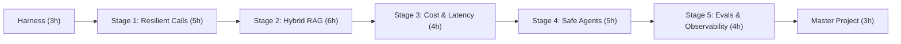

# AI Backend Engineering Fundamentals

Production-grade engineering patterns, resilient architectures, and hands-on implementations for Senior Web Backend Developers building AI-native systems.

Based on practical distributed systems principles: treating LLMs as untrusted, high-latency RPCs, building hybrid dense/sparse retrieval engines with Reciprocal Rank Fusion, applying multi-tier caching (exact + semantic) and complexity routing, bounding autonomous agents with step budgets and idempotency keys, and guarding prompts with CI regression eval harnesses.

Implemented entirely in **TypeScript / Node.js** with zero external paid API key prerequisites for offline development and testing.

---

## 30-Hour Curriculum Overview

A structured schedule designed for a Senior Web Backend Developer to review, understand, and master the full spectrum of production AI backend engineering within approximately 30 hours.



| Phase | Module | Distributed Systems Mental Model | Practical Implementation | Study Time |
| :--- | :--- | :--- | :--- | :--- |
| **00** | [AI Management Harness](file:///Users/siminshoeibizadeh/mienne/Programming/dev/projects/dev-mine/ai-backend-engineering-fundumentals/harness/docs/README.md) | Operational control plane, sliding context window | [PromptHarness.ts](file:///Users/siminshoeibizadeh/mienne/Programming/dev/projects/dev-mine/ai-backend-engineering-fundumentals/harness/src/PromptHarness.ts) | 3 Hours |
| **01** | [Stage 1: LLM Calls as RPCs](file:///Users/siminshoeibizadeh/mienne/Programming/dev/projects/dev-mine/ai-backend-engineering-fundumentals/stages/01-resilient-llm-calls/docs/README.md) | Flaky downstream dependency, deadlines, circuit breakers | [ResilientLLMClient.ts](file:///Users/siminshoeibizadeh/mienne/Programming/dev/projects/dev-mine/ai-backend-engineering-fundumentals/stages/01-resilient-llm-calls/src/ResilientLLMClient.ts) | 5 Hours |
| **02** | [Stage 2: Hybrid Retrieval](file:///Users/siminshoeibizadeh/mienne/Programming/dev/projects/dev-mine/ai-backend-engineering-fundumentals/stages/02-retrieval-rag/docs/README.md) | Dual indexing, inverted indices, RRF rank fusion, decay | [HybridSearchEngine.ts](file:///Users/siminshoeibizadeh/mienne/Programming/dev/projects/dev-mine/ai-backend-engineering-fundumentals/stages/02-retrieval-rag/src/HybridSearchEngine.ts) | 6 Hours |
| **03** | [Stage 3: Cost & Latency](file:///Users/siminshoeibizadeh/mienne/Programming/dev/projects/dev-mine/ai-backend-engineering-fundumentals/stages/03-cost-and-latency/docs/README.md) | L1 exact hash cache + L2 high-dimensional semantic cache | [CostLatencyOptimizer.ts](file:///Users/siminshoeibizadeh/mienne/Programming/dev/projects/dev-mine/ai-backend-engineering-fundumentals/stages/03-cost-and-latency/src/CostLatencyOptimizer.ts) | 4 Hours |
| **04** | [Stage 4: Safe Agents](file:///Users/siminshoeibizadeh/mienne/Programming/dev/projects/dev-mine/ai-backend-engineering-fundumentals/stages/04-production-agents/docs/README.md) | Bounded state machines, step budgets, idempotency keys, HITL | [SafeAgentRunner.ts](file:///Users/siminshoeibizadeh/mienne/Programming/dev/projects/dev-mine/ai-backend-engineering-fundumentals/stages/04-production-agents/src/SafeAgentRunner.ts) | 5 Hours |
| **05** | [Stage 5: Evals & Tracing](file:///Users/siminshoeibizadeh/mienne/Programming/dev/projects/dev-mine/ai-backend-engineering-fundumentals/stages/05-evals-observability/docs/README.md) | Golden test suites, LLM judge, OpenTelemetry spans, CI gating | [CIEvalRunner.ts](file:///Users/siminshoeibizadeh/mienne/Programming/dev/projects/dev-mine/ai-backend-engineering-fundumentals/stages/05-evals-observability/src/CIEvalRunner.ts) | 4 Hours |
| **06** | [Master Project: Smart Contact List](file:///Users/siminshoeibizadeh/mienne/Programming/dev/projects/dev-mine/ai-backend-engineering-fundumentals/projects/smart-contact-list/docs/README.md) | Full microservice synthesizing all 5 stages | [SmartContactService.ts](file:///Users/siminshoeibizadeh/mienne/Programming/dev/projects/dev-mine/ai-backend-engineering-fundumentals/projects/smart-contact-list/src/SmartContactService.ts) | 3 Hours |

---

## Architectural Principles for Backend Developers

1. **Strict Code & Documentation Isolation:**
   Markdown files (`.md`) are dedicated to architecture, theory, distributed systems tradeoffs, and tracing walkthroughs with direct links to source files. Zero code blocks are dumped into markdown documentation.
   TypeScript files (`.ts`) contain full, working production implementations with detailed architectural comments placed directly above classes and methods.

2. **Every Stage is Atomic & Self-Contained:**
   Each module maintains its own `docs/`, `src/`, `tests/`, and an atomic `status.md` file tracking implementation completeness and test pass rates.

3. **Deterministic & Network-Resilient:**
   All components run offline deterministically using high-fidelity provider simulators while adhering to real provider interfaces (OpenAI, Gemini, Anthropic compatible). No expensive API keys are needed to run tests or verify behavior.

---

## Repository Structure

```text
├── docs/
│   └── ai-asistant/              # User requirements, initial prompt, and assistant guidelines
├── plans/                        # 30-hour curriculum breakdown, blueprints, execution milestones
├── harness/                      # AI Management Harness (Prompt contracts, token budgets, guardrails)
├── stages/
│   ├── 01-resilient-llm-calls/   # Timeouts, retries with jitter, circuit breaker, schemas, cost logs
│   ├── 02-retrieval-rag/         # Sliding chunking, dense embeddings, BM25, RRF, freshness decay
│   ├── 03-cost-and-latency/      # Exact SHA-256 cache, semantic vector cache, model routing, batching
│   ├── 04-production-agents/     # ReAct loop, step budgets, idempotent tools, human approval gate
│   └── 05-evals-observability/   # Golden datasets, LLM judge, OpenTelemetry tracer, CI eval gating
├── projects/
│   └── smart-contact-list/       # Master Project: Contact & Context Intelligence Microservice
├── package.json
├── tsconfig.json
└── status.md                     # Global project status & milestone tracker
```

---

## Getting Started

### Prerequisites
- Node.js runtime (v20+) or Bun runtime (v1.1+)
- Git

### Installation
Dependencies can be installed via npm or bun:
- Run `npm install` or `bun install`

### Running Test Suites
To run all 35 tests across the entire repository:
- Run `npm test` or `bun test`

To run specific stage tests:
- Stage 1: `npm run test:stage1`
- Stage 2: `npm run test:stage2`
- Stage 3: `npm run test:stage3`
- Stage 4: `npm run test:stage4`
- Stage 5: `npm run test:stage5`
- Harness: `npm run test:harness`
- Master Project: `npm run test:project`

---

## Detailed Stage Reference Index

- **Harness:** [Harness Guide](file:///Users/siminshoeibizadeh/mienne/Programming/dev/projects/dev-mine/ai-backend-engineering-fundumentals/harness/docs/README.md) | [Source Code](file:///Users/siminshoeibizadeh/mienne/Programming/dev/projects/dev-mine/ai-backend-engineering-fundumentals/harness/src/) | [Status](file:///Users/siminshoeibizadeh/mienne/Programming/dev/projects/dev-mine/ai-backend-engineering-fundumentals/harness/status.md)
- **Stage 1 (Resilient Calls):** [Knowledge Guide](file:///Users/siminshoeibizadeh/mienne/Programming/dev/projects/dev-mine/ai-backend-engineering-fundumentals/stages/01-resilient-llm-calls/docs/knowledge.md) | [Source Code](file:///Users/siminshoeibizadeh/mienne/Programming/dev/projects/dev-mine/ai-backend-engineering-fundumentals/stages/01-resilient-llm-calls/src/) | [Status](file:///Users/siminshoeibizadeh/mienne/Programming/dev/projects/dev-mine/ai-backend-engineering-fundumentals/stages/01-resilient-llm-calls/status.md)
- **Stage 2 (Hybrid RAG):** [Knowledge Guide](file:///Users/siminshoeibizadeh/mienne/Programming/dev/projects/dev-mine/ai-backend-engineering-fundumentals/stages/02-retrieval-rag/docs/knowledge.md) | [Source Code](file:///Users/siminshoeibizadeh/mienne/Programming/dev/projects/dev-mine/ai-backend-engineering-fundumentals/stages/02-retrieval-rag/src/) | [Status](file:///Users/siminshoeibizadeh/mienne/Programming/dev/projects/dev-mine/ai-backend-engineering-fundumentals/stages/02-retrieval-rag/status.md)
- **Stage 3 (Optimization):** [Knowledge Guide](file:///Users/siminshoeibizadeh/mienne/Programming/dev/projects/dev-mine/ai-backend-engineering-fundumentals/stages/03-cost-and-latency/docs/knowledge.md) | [Source Code](file:///Users/siminshoeibizadeh/mienne/Programming/dev/projects/dev-mine/ai-backend-engineering-fundumentals/stages/03-cost-and-latency/src/) | [Status](file:///Users/siminshoeibizadeh/mienne/Programming/dev/projects/dev-mine/ai-backend-engineering-fundumentals/stages/03-cost-and-latency/status.md)
- **Stage 4 (Safe Agents):** [Knowledge Guide](file:///Users/siminshoeibizadeh/mienne/Programming/dev/projects/dev-mine/ai-backend-engineering-fundumentals/stages/04-production-agents/docs/knowledge.md) | [Source Code](file:///Users/siminshoeibizadeh/mienne/Programming/dev/projects/dev-mine/ai-backend-engineering-fundumentals/stages/04-production-agents/src/) | [Status](file:///Users/siminshoeibizadeh/mienne/Programming/dev/projects/dev-mine/ai-backend-engineering-fundumentals/stages/04-production-agents/status.md)
- **Stage 5 (Evals & Observability):** [Knowledge Guide](file:///Users/siminshoeibizadeh/mienne/Programming/dev/projects/dev-mine/ai-backend-engineering-fundumentals/stages/05-evals-observability/docs/knowledge.md) | [Source Code](file:///Users/siminshoeibizadeh/mienne/Programming/dev/projects/dev-mine/ai-backend-engineering-fundumentals/stages/05-evals-observability/src/) | [Status](file:///Users/siminshoeibizadeh/mienne/Programming/dev/projects/dev-mine/ai-backend-engineering-fundumentals/stages/05-evals-observability/status.md)
- **Master Project:** [Project Architecture](file:///Users/siminshoeibizadeh/mienne/Programming/dev/projects/dev-mine/ai-backend-engineering-fundumentals/projects/smart-contact-list/docs/README.md) | [Source Code](file:///Users/siminshoeibizadeh/mienne/Programming/dev/projects/dev-mine/ai-backend-engineering-fundumentals/projects/smart-contact-list/src/) | [Status](file:///Users/siminshoeibizadeh/mienne/Programming/dev/projects/dev-mine/ai-backend-engineering-fundumentals/projects/smart-contact-list/status.md)
