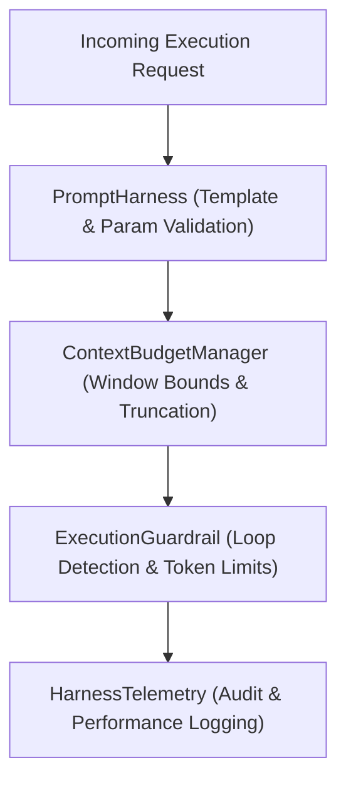

# AI Management Harness

The Harness is an operational control plane that surrounds, bounds, and monitors all LLM interactions in backend services.

## Core Capabilities

1. **Prompt Contract Management:** Versioned prompt templates with mandatory variable enforcement and strict validation.
   - Implementation: [PromptHarness.ts](file:///Users/siminshoeibizadeh/mienne/Programming/dev/projects/dev-mine/ai-backend-engineering-fundumentals/harness/src/PromptHarness.ts)

2. **Context Budgeting & Truncation:** Finite token window allocation across System Prompts, Injected RAG Context, Chat History, and Reserved Completion space.
   - Implementation: [ContextBudgetManager.ts](file:///Users/siminshoeibizadeh/mienne/Programming/dev/projects/dev-mine/ai-backend-engineering-fundumentals/harness/src/ContextBudgetManager.ts)

3. **Execution Guardrails:** Deterministic tripwires preventing runaway agent loops, schema non-compliance, and token overflows.
   - Implementation: [ExecutionGuardrail.ts](file:///Users/siminshoeibizadeh/mienne/Programming/dev/projects/dev-mine/ai-backend-engineering-fundumentals/harness/src/ExecutionGuardrail.ts)

4. **Telemetry & Audit Emission:** Emits structured events with execution timings, token usages, and financial cost accounting.
   - Implementation: [HarnessTelemetry.ts](file:///Users/siminshoeibizadeh/mienne/Programming/dev/projects/dev-mine/ai-backend-engineering-fundumentals/harness/src/HarnessTelemetry.ts)

## Architecture & Data Flow

## Test Suite
- Comprehensive unit tests: [Harness.test.ts](file:///Users/siminshoeibizadeh/mienne/Programming/dev/projects/dev-mine/ai-backend-engineering-fundumentals/harness/tests/Harness.test.ts)

