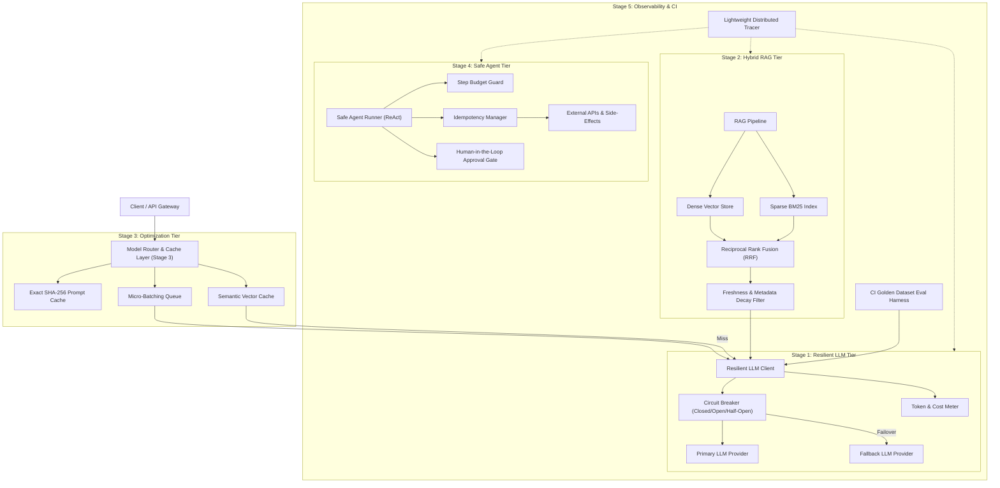

# Architecture Blueprint: Production AI Backend Engineering

This document specifies the technical architecture, component boundaries, and interaction flows across the entire platform.

## 1. High-Level System Architecture

---

## 2. Component Specifications

### 2.1 Resilient LLM Layer (Stage 1)
- **Role:** Guarantees fault tolerance for non-deterministic and flaky LLM providers.
- **Key Invariants:**
  - Every external call is bounded by an explicit timeout deadline (`AbortSignal`).
  - Retries apply exponential backoff with randomized full jitter to prevent synchronized retry spikes.
  - Failures trigger circuit breaker state transitions (3 failures -> OPEN state for 30 seconds).
  - Unrecoverable primary errors fall back to an auxiliary, lightweight model.
  - Responses are parsed against strict runtime schemas with deterministic error handling.

### 2.2 Hybrid Retrieval Engine (Stage 2)
- **Role:** High-accuracy document and context retrieval combining semantic intent with exact keyword matching.
- **Key Invariants:**
  - Token chunking enforces sliding windows with token boundaries to prevent context fragmentation.
  - Hybrid scoring uses Reciprocal Rank Fusion: rank score is computed as `1 / (k + rank)`.
  - Freshness filtering applies exponential decay based on document timestamp age: `decay = exp(-lambda * deltaDays)`.
  - Generation outputs include strict provenance citations pointing to source chunk IDs.

### 2.3 Optimization & Caching Engine (Stage 3)
- **Role:** Minimizes operational cost and response latency through multi-tier caching and intelligent routing.
- **Key Invariants:**
  - Tier 1 Exact Cache: Fast in-memory SHA-256 hash lookup with microsecond access.
  - Tier 2 Semantic Cache: High-dimensional vector cosine similarity lookup. If similarity is greater than or equal to the threshold (e.g., 0.92), returns cached result without downstream LLM call.
  - Dynamic Router: Classifies prompts into low-complexity (routed to small, cost-efficient model) and high-complexity (routed to frontier model).

### 2.4 Safe Agent Execution Engine (Stage 4)
- **Role:** Orchestrates autonomous agent tool calling while maintaining deterministic control boundaries.
- **Key Invariants:**
  - Maximum iteration budget: The ReAct loop terminates if the step budget (e.g., 6 steps) is exceeded.
  - Idempotent tool execution: Mutations take an `idempotencyKey`. Repeated tool calls return the cached execution result without re-executing side-effects.
  - Sensitive operations (e.g., issuing monetary refunds or deleting entities) halt agent execution and generate an `ApprovalToken` pending human review.

### 2.5 Observability & CI Evaluation Harness (Stage 5)
- **Role:** Continuous verification and distributed tracing across all AI interactions.
- **Key Invariants:**
  - Hierarchical tracing spans record start/end timestamps, token counts, cost, and metadata attributes.
  - Golden test datasets are evaluated across deterministic and LLM-as-judge rubrics.
  - The CI eval runner enforces score thresholds (e.g. minimum 90% accuracy) and fails the build on regression.

