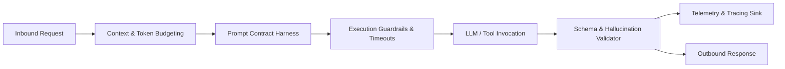

# Harness Engineering Flow for Managing AI in Backend Services

Harness engineering is the discipline of wrapping, bounding, monitoring, and safely deploying AI components within backend distributed systems. 

## 1. Why Harness Engineering?
Without an engineering harness, LLMs in backend systems create major risks:
- Unbounded context consumption leading to memory/token exhaustion.
- Silent model hallucinations breaking downstream schemas.
- Infinite agent tool loops consuming hundreds of dollars in seconds.
- Lack of observability making debugging stochastic errors impossible.

---

## 2. The Four Pillars of the AI Harness

### Pillar 1: Context Budget Manager
- Manages the finite context window budget across:
  1. System Prompt & Instructions (fixed budget)
  2. External Retrieval Context / Injected Data (capped budget)
  3. Conversation History (sliding window / LRU eviction)
  4. Response Generation Buffer (reserved output budget)
- Automatically computes token overhead and applies truncation strategies (e.g. oldest message eviction, middle truncation) before sending payloads downstream.

### Pillar 2: Prompt Contract Harness
- Treats prompts as versioned, strongly-typed code contracts rather than loose string concatenations.
- Enforces runtime variable interpolation and ensures no unresolved template placeholders exist.
- Validates prompt size against the configured token ceiling before execution.

### Pillar 3: Execution Guardrails & Circuit Breakers
- Enforces strict execution limits:
  - Global wall-clock timeout budget.
  - Maximum tool step limit for agents.
  - Loop tripwires: Halts execution if identical tool calls or thought patterns repeat consecutively.
- Isolates side-effects behind idempotency keys.

### Pillar 4: Telemetry & Evaluation Sink
- Records structured telemetry for every AI interaction:
  - Prompt and completion token counts.
  - Cost in USD per request.
  - End-to-end latency and time-to-first-token (TTFT).
  - Validation failures and retry counts.
- Emits traces compatible with OpenTelemetry collectors.
