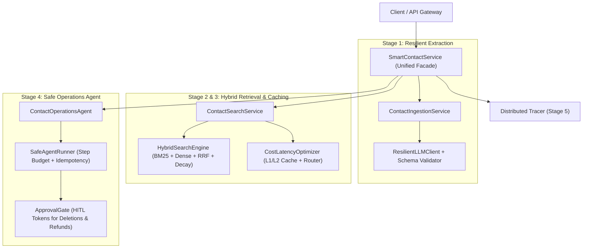

# Master Project: Smart Contact List (Context & Contact Intelligence Service)

The **Smart Contact List** is an enterprise contact and context intelligence microservice. It synthesizes all five core pillars of production AI backend engineering into a unified, battle-tested system.

## Architectural Synthesis

---

## Component Map

| Component | Role | Implementation |
| :--- | :--- | :--- |
| **Domain Types & Contracts** | Contact, interaction note, and query data contracts | [ContactTypes.ts](file:///Users/siminshoeibizadeh/mienne/Programming/dev/projects/dev-mine/ai-backend-engineering-fundumentals/projects/smart-contact-list/src/ContactTypes.ts) |
| **Ingestion Service** | Extracts structured contacts from messy unstructured text with schema validation | [ContactIngestionService.ts](file:///Users/siminshoeibizadeh/mienne/Programming/dev/projects/dev-mine/ai-backend-engineering-fundumentals/projects/smart-contact-list/src/ContactIngestionService.ts) |
| **Search Service** | Semantic + lexical hybrid search with freshness decay and two-tier caching | [ContactSearchService.ts](file:///Users/siminshoeibizadeh/mienne/Programming/dev/projects/dev-mine/ai-backend-engineering-fundumentals/projects/smart-contact-list/src/ContactSearchService.ts) |
| **Operations Agent** | Autonomous CRM agent handling safe lookups and gated mutations (deletions, refunds) | [ContactOperationsAgent.ts](file:///Users/siminshoeibizadeh/mienne/Programming/dev/projects/dev-mine/ai-backend-engineering-fundumentals/projects/smart-contact-list/src/ContactOperationsAgent.ts) |
| **Master Service Facade** | Unifies ingestion, search, safe agent ops, and OpenTelemetry tracing | [SmartContactService.ts](file:///Users/siminshoeibizadeh/mienne/Programming/dev/projects/dev-mine/ai-backend-engineering-fundumentals/projects/smart-contact-list/src/SmartContactService.ts) |

## Documentation & Exercises
- [Knowledge Guide](file:///Users/siminshoeibizadeh/mienne/Programming/dev/projects/dev-mine/ai-backend-engineering-fundumentals/projects/smart-contact-list/docs/knowledge.md)
- [Tracing Tasks](file:///Users/siminshoeibizadeh/mienne/Programming/dev/projects/dev-mine/ai-backend-engineering-fundumentals/projects/smart-contact-list/docs/tracing-tasks.md)
- [Code Tasks & Acceptance Criteria](file:///Users/siminshoeibizadeh/mienne/Programming/dev/projects/dev-mine/ai-backend-engineering-fundumentals/projects/smart-contact-list/docs/code-tasks.md)
- [Project Status](file:///Users/siminshoeibizadeh/mienne/Programming/dev/projects/dev-mine/ai-backend-engineering-fundumentals/projects/smart-contact-list/status.md)
