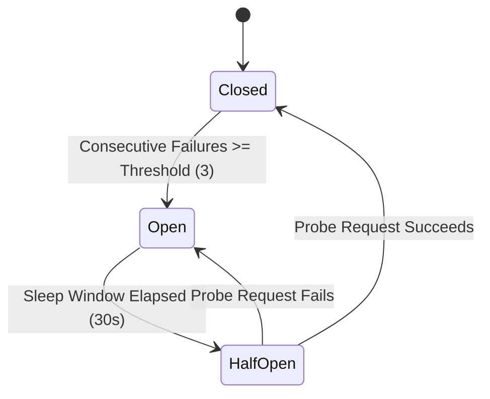

# Stage 1 Knowledge: Distributed Resilience Patterns for LLMs

## 1. Tokens vs. Characters: The Cost and Latency Metric
Unlike traditional databases where payloads are measured in bytes, LLMs compute over discrete sub-word units called tokens.
- **Rule of thumb:** In English prose, 100 tokens correspond to approximately 75 words (~400 characters).
- **Latency impact:** Time-to-first-token (TTFT) is governed by prompt token length (pre-fill phase). Generation throughput (tokens/sec) is governed by completion token length (decode phase).
- **Cost impact:** Pricing is asymmetric: output tokens typically cost 3x to 5x more than input tokens due to the autoregressive sequential decode cost.
- **Reference:** See [TokenCounter.ts](file:///Users/siminshoeibizadeh/mienne/Programming/dev/projects/dev-mine/ai-backend-engineering-fundumentals/stages/01-resilient-llm-calls/src/TokenCounter.ts) and [CostCalculator.ts](file:///Users/siminshoeibizadeh/mienne/Programming/dev/projects/dev-mine/ai-backend-engineering-fundumentals/stages/01-resilient-llm-calls/src/CostCalculator.ts).

---

## 2. Streaming via Server-Sent Events (SSE)
A 500-token completion might take 5 to 10 seconds. In synchronous HTTP requests, holding open a socket idle for 10 seconds degrades backend thread pools and user experience.
- Streaming utilizes `text/event-stream` chunks delivered asynchronously via Node.js async iterators.
- Clients receive progressive tokens immediately, dropping perceived latency from 10 seconds down to sub-500ms TTFT.
- Cancellation: If a client disconnects, the backend must immediately abort the upstream connection via `AbortController` to avoid burning unnecessary tokens and compute charges.

---

## 3. Timeout Deadlines & Cancellation Propagation
LLM APIs frequently suffer from "tail latency spikes" where a single request hangs for 30+ seconds due to GPU scheduling queue contention.
- In distributed microservices, every outbound call must carry an explicit deadline.
- When the deadline expires, an `AbortSignal` is dispatched, tearing down the HTTP connection.
- **Reference:** See [ResilientLLMClient.ts](file:///Users/siminshoeibizadeh/mienne/Programming/dev/projects/dev-mine/ai-backend-engineering-fundumentals/stages/01-resilient-llm-calls/src/ResilientLLMClient.ts).

---

## 4. Exponential Backoff with Full Jitter
When an LLM provider returns HTTP 429 (Rate Limit Exceeded) or 503 (Overloaded), naïve retries cause a "thundering herd" problem that exacerbates the outage.
- **Exponential Backoff:** Multiplies base delay by `2^attempt`.
- **Full Jitter:** Rather than waiting exact backoff time `T`, pick a uniform random number between `0` and `T`.
- Full jitter mathematically flattens retry spikes, allowing provider queues to clear smoothly.

---

## 5. Circuit Breaker State Machine
When an upstream model provider fails completely (e.g. cloud region outage), retrying every request exhausts local connection pools and introduces massive latency to end users.

- **Closed:** Normal operation. Requests pass through to the primary provider.
- **Open:** Provider is presumed dead. All inbound requests fail fast immediately without making a network call.
- **Half-Open:** Allows a single probe request through. If it succeeds, the breaker resets to Closed. If it fails, the breaker trips back to Open.
- **Reference:** See [CircuitBreaker.ts](file:///Users/siminshoeibizadeh/mienne/Programming/dev/projects/dev-mine/ai-backend-engineering-fundumentals/stages/01-resilient-llm-calls/src/CircuitBreaker.ts).

---

## 6. Model Fallback Cascades
When the primary frontier model (e.g., Gemini 1.5 Pro) fails or trips the circuit breaker, the client automatically degrades gracefully by routing the request to a faster secondary fallback model (e.g., Gemini 1.5 Flash).
- This pattern preserves service availability at the cost of slight reasoning depth, preventing user-facing HTTP 500 errors.

---

## 7. Structured Outputs via Schema Validation
LLMs are probabilistic and cannot guarantee JSON syntax out-of-the-box.
- Backend systems require strict contracts.
- The resilient client forces structured generation and runs responses through runtime Zod schema parsing.
- If parsing fails, the client triggers a schema-correcting retry prompt before bubbling an exception up to the domain layer.
