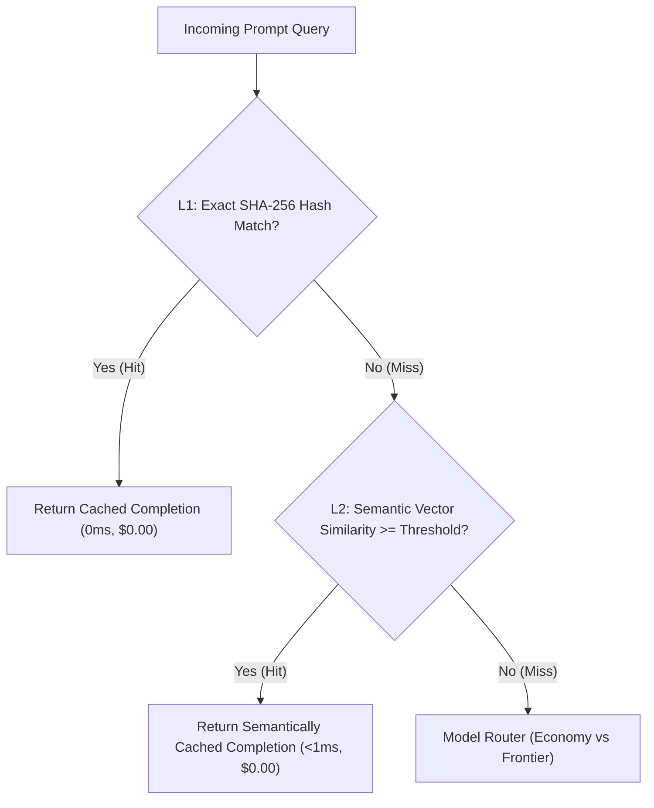

# Stage 3 Knowledge: Cost & Latency Optimization Patterns

## 1. Multi-Tiered AI Caching Architecture
In conventional web services, caching checks exact keys (e.g. `user:1234`). In generative AI, users ask identical questions with varying phrasing ("How do I refund?" vs "What is the process to get my money back?").

- **L1 Exact Cache:** Cryptographic SHA-256 hash of prompt text. Complexity: $O(1)$ memory lookup. Sub-millisecond latency.
- **L2 Semantic Cache:** Encodes incoming prompt into dense vector space, querying previous queries for cosine similarity. If similarity $\ge \tau$ (e.g., $0.88$), returns cached response.
- **Threshold Tradeoff:**
  - *Too high (e.g. 0.98):* Cache miss rate increases; negligible savings.
  - *Too low (e.g. 0.70):* False positive cache hits return inaccurate answers to subtly different questions.
- **Reference:** See [ExactPromptCache.ts](file:///Users/siminshoeibizadeh/mienne/Programming/dev/projects/dev-mine/ai-backend-engineering-fundumentals/stages/03-cost-and-latency/src/ExactPromptCache.ts) and [SemanticCache.ts](file:///Users/siminshoeibizadeh/mienne/Programming/dev/projects/dev-mine/ai-backend-engineering-fundumentals/stages/03-cost-and-latency/src/SemanticCache.ts).

---

## 2. Dynamic Model Routing
Not all queries require a multi-billion parameter frontier model ($3.50+ per 1M tokens). Over 60% of real enterprise queries are simple lookups, single-word entity extractions, or basic conversational greetings that a lightweight economy model ($0.075 per 1M tokens) solves perfectly.
- **Complexity Classifier:**
  - Prompt token length threshold (e.g., queries $< 50$ tokens with simple directives).
  - Reasoning indicators (e.g., presence of keywords like "compare", "analyze", "synthesize", multi-step constraints).
  - Code generation or multi-step logic requirements.
- **Economy Tier Routing:** Routes straightforward tasks to `gemini-1.5-flash` or `gpt-4o-mini`.
- **Frontier Tier Routing:** Reserves `gemini-1.5-pro` or `claude-3-5-sonnet` strictly for high-entropy cognitive synthesis.
- **Economic Impact:** Routing 70% of traffic to the economy tier cuts total monthly token expenditure by over 80%.
- **Reference:** See [ModelRouter.ts](file:///Users/siminshoeibizadeh/mienne/Programming/dev/projects/dev-mine/ai-backend-engineering-fundumentals/stages/03-cost-and-latency/src/ModelRouter.ts).

---

## 3. Micro-Batching Queues
In high-concurrency systems, processing individual HTTP requests sequentially introduces significant TCP and TLS overhead and misses batch pricing optimizations.
- **Micro-Batching:** Holds incoming requests in an in-memory queue for a small time window (e.g. 20ms) or until a batch threshold (e.g. 5 items) is reached.
- Once tripped, the batch is dispatched in parallel or via multi-prompt batch endpoints.
- Amortizes connection setup costs and maximizes backend pipeline throughput.
- **Reference:** See [RequestBatcher.ts](file:///Users/siminshoeibizadeh/mienne/Programming/dev/projects/dev-mine/ai-backend-engineering-fundumentals/stages/03-cost-and-latency/src/RequestBatcher.ts).
