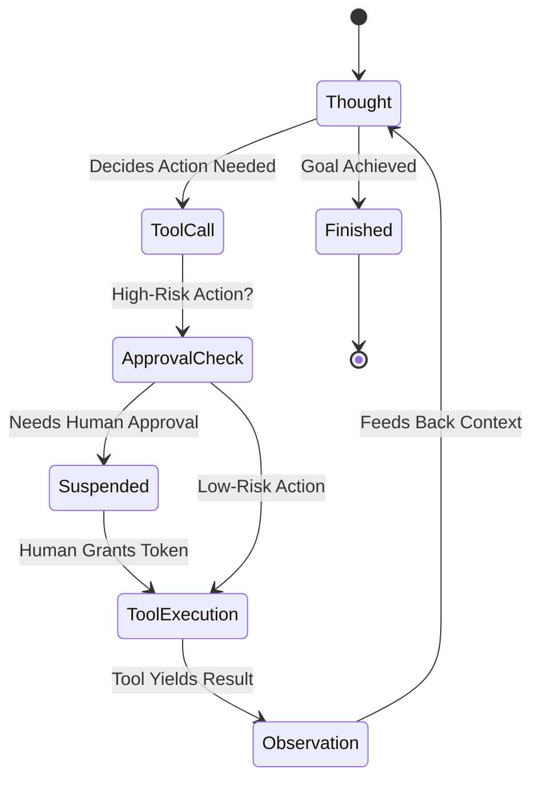

# Stage 4 Knowledge: Production Agent Safety Architecture

## 1. The ReAct Loop as a Finite State Machine
A production agent is not an open-ended conversationalist; it is a discrete state machine cycling through four deterministic states:

---

## 2. Step Budgets & Loop Tripwires
Unconstrained agents frequently get stuck in reasoning deadlocks (e.g. searching for a missing ID in a loop).
- **Step Budget:** An invariant integer ceiling (e.g., maximum 6 iterations).
- If the agent reaches step 6 without reaching `Finished`, execution is aborted with `StepBudgetExceededError`.
- This bounds the maximum token consumption and execution latency of every agent run.
- **Reference:** See [SafeAgentRunner.ts](file:///Users/siminshoeibizadeh/mienne/Programming/dev/projects/dev-mine/ai-backend-engineering-fundumentals/stages/04-production-agents/src/SafeAgentRunner.ts).

---

## 3. Idempotent Tools: Stripe-Style Safety Keys
When an agent calls an external API that causes side-effects (e.g., `issue_refund`, `send_email`, `charge_card`), network timeouts or agent self-retries can cause duplicate executions.
- **Idempotency Key:** A unique token generated per business transaction (e.g. `hash(orderId, amount)`).
- When a tool is called with an `idempotencyKey`:
  1. The tool checks the idempotency store.
  2. If the key exists, the tool **bypasses execution** and immediately returns the cached prior result.
  3. If the key is new, the tool executes the mutation and commits the result to the store.
- Guarantees **At-Most-Once** execution semantics for external side effects.
- **Reference:** See [IdempotencyStore.ts](file:///Users/siminshoeibizadeh/mienne/Programming/dev/projects/dev-mine/ai-backend-engineering-fundumentals/stages/04-production-agents/src/IdempotencyStore.ts).

---

## 4. Human-in-the-Loop (HITL) Approval Gating
Certain business operations must never be fully automated without human oversight:
- Issuing refunds exceeding a monetary threshold (e.g. $> \$50$).
- Deleting customer records or account data.
- Sending high-volume external notifications.
- **HITL Workflow:**
  1. Tool definition tags the action as `REQUIRES_APPROVAL`.
  2. Agent halts execution, transitions to `NEEDS_APPROVAL`, and emits a secure `approvalToken`.
  3. The agent state is serialized and persisted.
  4. An operator reviews the payload in an administrative dashboard and invokes `approve(token)`.
  5. The agent resumes execution, executes the approved tool, and completes the workflow.
- **Reference:** See [ApprovalGate.ts](file:///Users/siminshoeibizadeh/mienne/Programming/dev/projects/dev-mine/ai-backend-engineering-fundumentals/stages/04-production-agents/src/ApprovalGate.ts).

