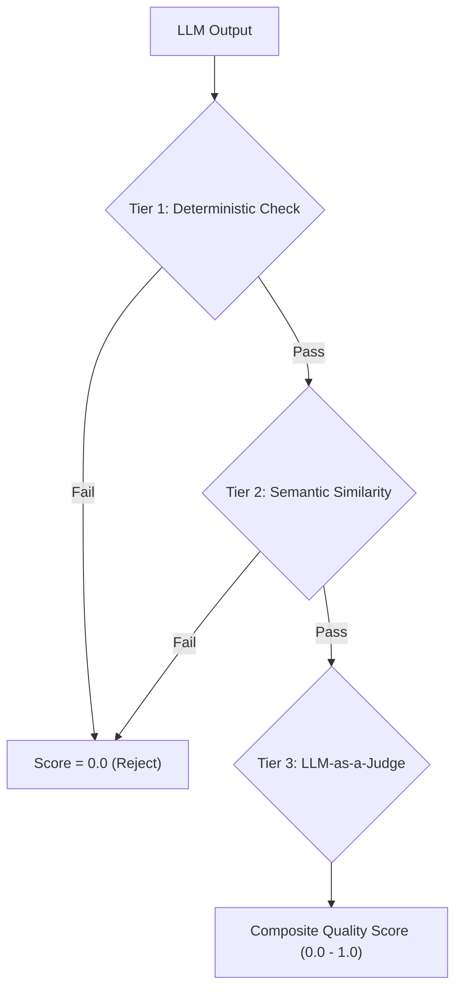

# Stage 5 Knowledge: Evals & Observability Architecture

## 1. Why Golden Datasets are the New Integration Tests
In standard backend engineering, assertions verify deterministic invariants (e.g. `expect(res.status).toBe(200)`). LLMs produce non-deterministic natural language outputs.
- A **Golden Dataset** consists of curated input samples paired with:
  1. Required structured schema formats.
  2. Ground-truth facts that must be present.
  3. Negative constraints (hallucinations or disallowed tokens that must NOT appear).
  4. Reference ideal outputs for semantic comparison.
- **Reference:** See [GoldenDataset.ts](file:///Users/siminshoeibizadeh/mienne/Programming/dev/projects/dev-mine/ai-backend-engineering-fundumentals/stages/05-evals-observability/src/GoldenDataset.ts).

---

## 2. Multi-Tiered Evaluators
Evaluating AI output requires a layered scoring strategy:

1. **Deterministic Evaluator (Fast, Cheap):**
   - Validates JSON schema adherence via Zod.
   - Asserts regex pattern matching (e.g., email or order ID formats).
   - Enforces latency bounds.
2. **Semantic Similarity Evaluator (Sub-millisecond):**
   - Computes embedding cosine similarity against the golden reference answer.
3. **LLM-as-a-Judge Evaluator (High-Fidelity):**
   - Invokes an evaluation prompt instructing a separate model to act as an impartial referee.
   - Evaluates on a standardized rubric (Factual Accuracy, Conciseness, Tone, Hallucination Absence).
   - Returns an integer score and explicit rationale.
- **Reference:** See [Evaluators.ts](file:///Users/siminshoeibizadeh/mienne/Programming/dev/projects/dev-mine/ai-backend-engineering-fundumentals/stages/05-evals-observability/src/Evaluators.ts).

---

## 3. Distributed Tracing: OpenTelemetry Model
Complex AI workflows involve multiple sub-operations: cache lookups, vector retrievals, multiple LLM retries, and tool calls.
- **Spans:** Represent atomic units of work with `traceId`, `spanId`, `parentSpanId`, start/end timestamps, and key-value attributes.
- Attributes record:
  - `llm.model`: model identifier.
  - `llm.prompt_tokens` & `llm.completion_tokens`: token accounting.
  - `llm.cost_usd`: financial expenditure.
  - `error`: exception details if failed.
- **Trace DAG:** Enables hierarchical visualization and bottleneck identification across the entire invocation lifecycle.
- **Reference:** See [Tracer.ts](file:///Users/siminshoeibizadeh/mienne/Programming/dev/projects/dev-mine/ai-backend-engineering-fundumentals/stages/05-evals-observability/src/Tracer.ts).

---

## 4. CI Regression Gating
Prompt engineering without CI evaluation is equivalent to deploying to production without running unit tests.
- When a developer edits a system prompt or switches model versions:
  1. The CI runner executes the candidate prompt against the Golden Dataset.
  2. Each test case is evaluated across deterministic and judge tiers.
  3. A composite benchmark score is computed.
  4. If the score falls below the required threshold (e.g. 90%), the runner exits with code `1`, blocking the pull request and preventing deployment.
- **Reference:** See [CIEvalRunner.ts](file:///Users/siminshoeibizadeh/mienne/Programming/dev/projects/dev-mine/ai-backend-engineering-fundumentals/stages/05-evals-observability/src/CIEvalRunner.ts).

